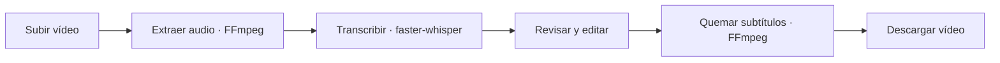

# Publicación de Subtitulator en GitHub (Open Source)

> Documento de referencia para subir **Subtitulator** a GitHub como proyecto open source.
> Recoge todas las decisiones, los archivos a crear y un checklist paso a paso con los
> comandos exactos. Léelo entero antes de empezar.

---

## 0. Decisiones acordadas

| Punto | Decisión |
|-------|----------|
| Estrategia de repo | **Repo nuevo e independiente** (`git init` propio en `Subtitulator/`) |
| Licencia | **MIT** |
| Autor | `l-i408` |
| Repositorio | `github.com/l-i408/subtitulator` |
| CI | **GitHub Actions completo** (tests backend + frontend + build) |
| Archivos comunidad | **Set completo** (README pro, LICENSE, CONTRIBUTING, CODE_OF_CONDUCT, SECURITY, CHANGELOG, plantillas) |

---

## 1. ⚠️ Aviso crítico: repositorio anidado

La raíz de git actual es **`C:/Users/onava`** (toda la carpeta de usuario es un repo) y su
`origin` apunta a **otro proyecto** (`agent-deploy-reviewer`). La carpeta `Subtitulator`
**no está trackeada** todavía.

**No reutilizar ese repo.** Hay que crear un repositorio independiente dentro de
`Subtitulator/` con historial limpio. Como `git init` dentro de un árbol ya versionado
puede dar avisos, conviene inicializar el repo propio y trabajar siempre desde
`C:/Users/onava/Desktop/Proyectos/Subtitulator`.

---

## 2. Archivos a crear antes de publicar

### 2.1 `.gitignore` (raíz del proyecto)

Debe excluir artefactos pesados, datos locales y secretos:

```gitignore
# Python
__pycache__/
*.py[cod]
.pytest_cache/
.venv/
venv/

# Datos y modelos (NO subir — pesados / locales)
backend/models/
backend/data/
*.db
*.sqlite3

# Entorno
**/.env
!**/.env.example

# Node / frontend
node_modules/
frontend/dist/
*.log

# Vídeos de prueba
*.mp4
*.mov
*.mkv
*.avi
*.webm

# Sistema / editor
.DS_Store
Thumbs.db
.vscode/
.idea/
```

> `backend/models/` ocupa ~464 MB y `backend/data/` contiene la BD y los vídeos de
> los jobs: ambos deben quedar fuera del repositorio.

### 2.2 `backend/.env.example`

```env
# Variables de entorno para desarrollo local (copiar a backend/.env)
APP_NAME=Subtitulator
APP_VERSION=0.1.0
WHISPER_MODEL=small
WHISPER_DEVICE=cpu
WHISPER_COMPUTE_TYPE=int8
MAX_FILE_SIZE_MB=500
MAX_DURATION_SECONDS=3600
```

### 2.3 `frontend/.env.example`

```env
# URL del backend (copiar a frontend/.env)
VITE_API_URL=http://localhost:8000
```

> No hay claves de API reales: Whisper se ejecuta en local. Aun así, los `.env` se
> excluyen por convención y se entregan los `.env.example`.

### 2.4 `LICENSE` (MIT)

Plantilla MIT estándar con `Copyright (c) 2026 l-i408`.

### 2.5 `README.md` (muy profesional y estilizado)

Estructura propuesta:

1. **Cabecera**: título + subtítulo + fila de **badges** (CI status, licencia MIT,
   Python, React, Docker).
2. **GIF/captura** del flujo (subida → revisión → descarga).
3. **Descripción** breve: qué es y qué problema resuelve.
4. **Características** (lista con iconos): transcripción local con Whisper, multi-idioma,
   edición de subtítulos, estilo personalizable, subtítulos quemados, historial.
5. **Diagrama de flujo** (Mermaid): `subir → extraer audio → transcribir → revisar →
   quemar → descargar`.
6. **Stack** en tabla (backend, transcripción, A/V, BD, frontend, despliegue).
7. **Instalación**:
   - **Docker (recomendado)**: `docker compose up --build`.
   - **Local**: backend (`uvicorn`) + frontend (`npm run dev`).
8. **Uso**: pasos de la interfaz.
9. **Estructura del proyecto** (árbol resumido).
10. **Tests**: cómo ejecutarlos (`pytest`, `npm test`).
11. **Roadmap** (YAGNI reservado: personalización avanzada de subtítulos, GPU/CUDA,
    traducción).
12. **Contribuir** + **Licencia**.

Diagrama Mermaid de referencia:



### 2.6 Archivos de comunidad

| Archivo | Contenido |
|---------|-----------|
| `CONTRIBUTING.md` | Cómo clonar, instalar, ejecutar tests, estilo de commits y proceso de PR |
| `CODE_OF_CONDUCT.md` | Contributor Covenant v2.1 |
| `SECURITY.md` | Cómo reportar vulnerabilidades (email de contacto), versiones soportadas |
| `CHANGELOG.md` | Formato *Keep a Changelog*; primera entrada `v0.1.0` |
| `.github/ISSUE_TEMPLATE/bug_report.md` | Plantilla de bug |
| `.github/ISSUE_TEMPLATE/feature_request.md` | Plantilla de feature |
| `.github/PULL_REQUEST_TEMPLATE.md` | Checklist de PR (tests pasan, docs actualizadas) |

---

## 3. Integración continua — `.github/workflows/ci.yml`

Workflow con dos jobs en `push` y `pull_request`:

```yaml
name: CI

on:
  push:
    branches: [main]
  pull_request:

jobs:
  backend:
    runs-on: ubuntu-latest
    defaults:
      run:
        working-directory: backend
    steps:
      - uses: actions/checkout@v4
      - uses: actions/setup-python@v5
        with:
          python-version: "3.11"
      - name: Instalar FFmpeg
        run: sudo apt-get update && sudo apt-get install -y ffmpeg
      - name: Instalar dependencias
        run: pip install -r requirements.txt
      - name: Ejecutar tests
        run: pytest -q

  frontend:
    runs-on: ubuntu-latest
    defaults:
      run:
        working-directory: frontend
    steps:
      - uses: actions/checkout@v4
      - uses: actions/setup-node@v4
        with:
          node-version: "20"
          cache: npm
          cache-dependency-path: frontend/package-lock.json
      - name: Instalar dependencias
        run: npm ci
      - name: Tests
        run: npm test
      - name: Build
        run: npm run build
```

> El badge de estado para el README:
> ``

> Nota: los tests del backend usan mocks para Whisper/FFmpeg, así que CI no descarga el
> modelo. FFmpeg se instala porque algunos tests de audio/render lo usan de verdad sobre
> ficheros sintéticos.

---

## 4. Checklist de publicación (paso a paso)

> Ejecutar todo desde `C:/Users/onava/Desktop/Proyectos/Subtitulator`.

### Paso 1 — Crear los archivos del apartado 2 y 3
Generar `.gitignore`, `.env.example` (×2), `LICENSE`, `README.md`, archivos de comunidad
y el workflow de CI.

### Paso 2 — Inicializar el repo independiente

```bash
git init
git branch -M main
git add .
git status   # verificar que NO aparecen models/, data/, .env ni *.mp4
```

### Paso 3 — Verificación de seguridad antes del primer commit

```bash
# Confirmar que no se trackean secretos ni archivos pesados
git ls-files | grep -E "\.env$|/models/|/data/|\.mp4$" || echo "OK: limpio"
```

Si aparece algo, revisar el `.gitignore` antes de continuar.

### Paso 4 — Primer commit

```bash
git commit -m "feat: Subtitulator — subtitulado automático de vídeo con Whisper + FFmpeg"
```

### Paso 5 — Crear el repo en GitHub y conectar

Con GitHub CLI:

```bash
gh repo create l-i408/subtitulator --public --source=. --remote=origin --push
```

O manualmente (crear el repo vacío en la web y luego):

```bash
git remote add origin https://github.com/l-i408/subtitulator.git
git push -u origin main
```

### Paso 6 — Configuración del repositorio en GitHub
- Añadir **descripción** y **topics**: `whisper`, `subtitles`, `ffmpeg`, `fastapi`,
  `react`, `video`, `transcription`, `open-source`.
- Activar **Issues** y **Discussions** (opcional).
- Comprobar que el **workflow de CI** se ejecuta y pasa (badge en verde).
- Subir una **captura/GIF** a `docs/assets/` y referenciarla en el README.

### Paso 7 — Release inicial (opcional)
- Crear tag `v0.1.0` y una **Release** en GitHub con notas desde el `CHANGELOG.md`.

---

## 5. Comprobaciones finales

- [ ] `models/`, `data/`, `.env` y vídeos **no** están en el repo.
- [ ] `.env.example` presentes en back y front.
- [ ] `README.md` renderiza badges, GIF y diagrama Mermaid correctamente.
- [ ] CI en verde (backend + frontend).
- [ ] `LICENSE` con autor y año correctos.
- [ ] Plantillas de issues/PR visibles al abrir un issue/PR.
- [ ] El repo clona y arranca con `docker compose up --build` en una máquina limpia.

---

## 6. Qué NO subir (resumen)

| Elemento | Motivo |
|----------|--------|
| `backend/models/` (~464 MB) | Se descarga solo en el primer uso |
| `backend/data/` y `*.db` | Datos locales de jobs y BD |
| `**/.env` | Configuración de entorno (se entrega `.env.example`) |
| `node_modules/`, `frontend/dist/` | Artefactos reproducibles |
| Vídeos de prueba (`*.mp4`, …) | Pesados y no relevantes |
